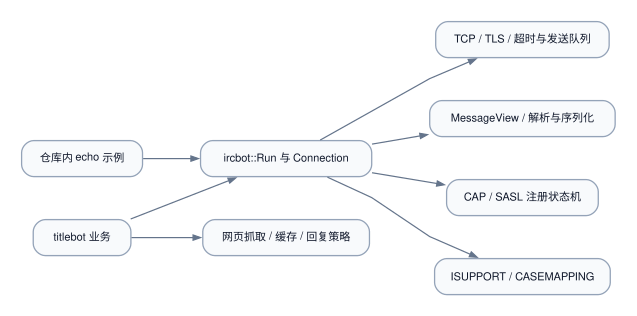

#+TITLE: ircbot 框架使用指南
#+OPTIONS: toc:2

* 范围与依赖

=ircbot= 是 titlebot 仓库内通用的 C++23 IRC 客户端模块. 它管理连接, TLS, 注册, 昵称冲突, 心跳, 重连,
发送队列, IRCv3 能力协商和 SASL, 业务由回调实现. titlebot 的网页抓取, 标题缓存, URL 选择和回复限流均
不属于该库.

公开头文件位于 =include/ircbot/=, 目标为 =ircbot::ircbot=. 直接依赖为 Boost 头文件, OpenSSL 和
pthread; 不依赖 Boost.URL, uchardet, zlib, spdlog 或 GoogleTest. 测试开启时才获取 GoogleTest.

只构建框架及示例:

#+begin_src sh
cmake -S . -B build-irc -DTITLEBOT_BUILD_APP=OFF -DTITLEBOT_ENABLE_TESTS=OFF -DIRCBOT_BUILD_EXAMPLES=ON
cmake --build build-irc --parallel
#+end_src

开启框架测试时将 =TITLEBOT_ENABLE_TESTS= 设为 =ON=, 然后运行:

#+begin_src sh
ctest --test-dir build-irc --output-on-failure
#+end_src

回环连接测试需要运行环境允许本地 socket. 当前构建要求 CMake 3.20 或以上, C++23 编译器及 Boost 1.81
或以上; 兼容基线为 Debian g++ 14.2.0.

仓库内的 =titlebot= 和 =ircbot_echo= 通过 CMake 目标 =ircbot::ircbot= 链接框架. 安装规则提供库与公开
头文件;

* 模块关系

#+begin_src dot :file modules.svg :results file
digraph ircbot {
  rankdir=LR;
  node [shape=box];

  titlebot      [label="titlebot 业务"];
  example       [label="仓库内 echo 示例"];
  client        [label="ircbot::Run 与 Connection"];
  transport     [label="TCP / TLS / 超时与发送队列"];
  message       [label="MessageView / 解析与序列化"];
  registration  [label="CAP / SASL 注册状态机"];
  features      [label="ISUPPORT / CASEMAPPING"];
  fetch         [label="网页抓取 / 缓存 / 回复策略"];

  titlebot -> client;
  example -> client;
  client -> { transport message registration features };
  titlebot -> fetch;
}
#+end_src

#+RESULTS:

协议组件可以独立进行离线解析和测试; 连接层通过事件回调把消息交给业务. 框架测试使用可注入的传输和时钟
驱动会话; 默认连接器负责 DNS, TCP 和 TLS.

* 启动与生命周期

完整可运行示例见 [[file:../examples/echo_bot.cpp][echo_bot.cpp]]. 示例使用 TLS, 收到 =!ping= 时向原频道或私聊发送 =pong=, 并将 SIGINT,
SIGTERM 转换为取消请求.

=ircbot::Config= 包含服务器, 端口, 昵称, 用户名, 真实名称, 频道列表, TLS, 认证和超时设置. 端口留空
时, TLS 使用 6697, 明文使用 6667; 用户名留空时使用昵称. 频道列表为独立字符串, 例如
={ "#one", "#two" }= 带密钥的频道同时配置

#+begin_src cpp
config.channel_keys["#two"] = "secret"
#+end_src

运行期成功入队的 =Join= 和 =Part= 会更新下次重连使用的频道列表.

=Run(config, handlers)= 返回 =boost::asio::awaitable<std::expected<void, ircbot::ClientError>>=. 调
用者通过 =co_await= 或 =co_spawn= 启动它, 不能把返回的 awaitable 当作已启动任务.

回调顺序与用途:

| 回调            | 触发时机                     | 用途                   |
|----------------+-----------------------------+-----------------------|
| =connected=    | TCP 和可选 TLS 已建立, 注册开始 | 创建本次连接的业务状态    |
| =ready=        | 收到欢迎消息, 必需认证已成功     | 执行注册后的业务操作      |
| =message=      | 框架处理完一条合法消息后        | 处理业务命令, 观察协议消息 |
| =disconnected= | 曾触发 connected 的连接被关闭  | 清理本次连接的业务状态    |
| =diagnostic=   | 连接, 协议或超时产生诊断        | 接入调用者的日志设施      |

=message= 也会收到注册阶段的消息; 业务若依赖已注册状态, 应由 =ready= 设置状态, 在 =disconnected= 中
清除. 注册时 432 表示昵称无效, 433 或针对昵称的 437 会触发有界的备选昵称尝试. 设置
=reclaim_nickname=true= 后, 若以备选昵称注册, 观察到原昵称持有者 QUIT 或改名时会尝试取回原昵称. 默认
配置协商能力, 同时兼容不支持 CAP 的旧服务器.

以收到 =:alice!u@host PRIVMSG #room :hello= 为例, 框架处理协议状态后先调用 =message=, 再按顺序执行
=middleware=. 任何中间件返回 =MessageFlow::kStop= 就结束这条消息的分发. 若全部放行, 按注册顺序调用匹
配的 =subscriptions=; 命令名忽略 ASCII 大小写, 空命令匹配全部. 中间件停止分发时, 原始回调已执行.

=AsPrivmsg= 可从这条消息取得目标 =#room= 和文本 =hello=. 通知与成员变更分别用 =AsNotice= 和
=AsMembershipChange= 读取. =User()=, =Host()=, =RawTags()= 均借用输入缓冲区. 回调可捕获只移动的对象.

所有回调同步运行在 =Run= 的 executor 上, 不能在其中阻塞, 同步抓网页或等待线程. 非诊断回调抛异常会结
束当前客户端并返回 =ClientError::kHandler=; 诊断回调异常被隔离.

* 消息解析与发送

=ParseMessage(line)= 接受不含 CRLF 的单行文本, 返回 =std::expected<MessageView, ParseError>=. 解析器
检查命令, 前缀, 标签和协议长度, 保留指向输入缓冲区的视图. 示例:

#+begin_src cpp
auto message = ircbot::ParseMessage(
    "@label=two\\swords :alice!user@host pRiVmSg #room :hello world");
if (message && ircbot::IsCommand(*message, "PRIVMSG")) {
    // message->Nick() == "alice"
    // message->params[0] == "#room"
    // message->params[1] == "hello world"
    // message->Tag("label") == "two words"
}
#+end_src

=MessageView= 本身及 =params= 中的字符串视图只在对应输入缓冲区有效时可用. 在 =Handlers::message= 中,
这个有效期结束于回调返回. 不能把整个 =MessageView= 复制进异步任务来延长字符串寿命; 应复制真正需要的
字段.

=IsCommand= 使用 ASCII 大小写不敏感比较. 昵称和频道使用服务器声明的规则: =Connection::Casemapping()=
返回 ASCII, RFC1459 或 strict-rfc1459, =Connection::IsSelf(nick)= 使用当前昵称和对应规则比较. 需要自
行比较时使用 =ircbot::Equals=. 例如 ASCII 模式下 =bot[= 和 =bot{= 是不同昵称.
=Connection::Features()= 提供当前 =005 ISUPPORT= 状态快照, 包括昵称长度和频道类型. 原始 ISUPPORT 信
息最多保留 256 项, 64 KiB 键值数据; 新未知项满额时忽略, 已有项更新及已识别字段可以逐出未知项腾出空
间.

发送 API:

| API | 输入与行为 |
|-----+------------|
| =Send(command, params, tags)= | 验证, 序列化参数及可选 IRCv3 标签后入队 |
| =Privmsg(target, text)=, =Notice(target, text)= | 发送一条聊天消息或通知 |
| =Join(channel, key)=, =Part(channel, reason)= | 加入或离开频道, 密钥与离开原因可省略 |
| =SendLine(line)= | 验证已组装且不含 CRLF 的客户端行后入队 |

这些 API 返回 =std::expected<void, SendError>=. 成功表示已进入本地发送队列, 不表示服务器已经收到或处
理. 输入不合法或超长时不会自动截断或拆行.

#+begin_src cpp
auto sent = connection.Privmsg("#room", "hello");
if (!sent) {
    // Handle sent.error(); success means queued, not acknowledged by the server.
}
#+end_src

连接默认可排队 64 行. =send_interval= 设置普通消息的最小发送间隔, 默认零; 设置 =send_delay= 后, 普通
行改用该回调返回的间隔, 结果限制在零至 24 小时. 注册, 心跳和退出控制消息具有优先级. 队满时可在会话执
行器上等待 =WaitWritable()=, 醒来后重新入队. 并发发送者可能先占用空位.

=TextBudget(target)= 优先使用观察到的自身前缀计算转发预算, 缺少前缀时用昵称与 USERLEN, HOSTLEN 估算;
已知前缀字节数时可直接调用 =PrivmsgTextBudget=. =SplitText("a猫b", 3)= 返回三个视图 ="a"=, ="猫"= 和
="b"=, 视图有效期取决于输入字符串. 发送 IRCv3 标签或 =TAGMSG= 前需要已启用 =message-tags=, 否则返回
=SendError::kCapabilityRequired=.

* 能力协商与 SASL

框架发送 =CAP LS 302=, 处理多段 =LS=, =ACK=, =NAK=, =LIST=, 以及运行中的 =NEW=, =DEL=. 按服务器提供
的能力请求配置项, 完成注册阶段协商后发送 =CAP END=. 可通过 =Connection::HasCapability(name)= 查询当
前已启用状态. =capabilities_changed= 接收 CAP NEW/DEL, =isupport_changed= 接收导致状态变化的 005.
=Feature("NETWORK")= 只复制指定字段, =NickLength()= 直接返回当前限制.

设置 =sasl_credentials= 后, 每次连接尝试从该函数获取 SASL 配置. 获取失败会终止连接. 内置认证机制为
PLAIN 和 EXTERNAL; 908 数值消息可用于读取服务器公布的机制列表.

| 能力 | 默认行为 | 框架提供的支持 |
|------+----------+----------------|
| =message-tags= | 请求 | 标签解析, 转义与发送前能力检查 |
| =server-time= | 请求 | 保留 =time= 标签, 业务可通过 =Tag("time")= 读取 |
| =sasl= | 配置认证后请求 | PLAIN, EXTERNAL, 分块 AUTHENTICATE 和成功/失败状态 |
| =cap-notify= | CAP 302 隐式启用 | 跟踪服务器 NEW, DEL 更新 |
| 其他能力 | 仅请求显式配置项 | 协商并报告启用状态; 额外业务语义由应用实现 |

例如:

#+begin_src cpp
config.registration.caps = {"message-tags", "server-time", "account-tag"};
#+end_src

配置项不支持时, 普通可选能力不会阻止注册. 为其他能力添加名字只表示请求该能力, 不意味着框架实现了该扩
展的全部业务行为.

SASL PLAIN 示例, 密码应由应用从环境变量, 配置存储等来源读取:

#+begin_src cpp
config.tls = true;
config.registration.sasl = ircbot::SaslConfig{
    .mechanism = ircbot::SaslMechanism::kPlain,
    .username = account,
    .password = password,
    .authzid = {},
    .required = true,
};
#+end_src

框架拒绝在明文连接上配置 PLAIN. =required=true= 是默认值: 服务器不支持, 拒绝或无法完成认证时返回认证
失败, 不进入未认证的正常会话. =required=false= 允许在认证不被支持或被拒绝时继续未认证注册; 仅在业务
允许时采用.

SASL EXTERNAL 通过已有传输身份认证, 例如 TLS 客户端证书:

#+begin_src cpp
config.tls = true;
config.certificate_file = "client.crt";
config.private_key_file = "client.key";
config.registration.sasl = ircbot::SaslConfig{
    .mechanism = ircbot::SaslMechanism::kExternal,
    .username = {},
    .password = {},
    .authzid = {},
    .required = true,
};
#+end_src

TLS 使用系统信任库并校验证书与服务器名称; =ca_file= 可增加受信任 CA. 客户端证书和私钥应同时提供.
=server_password= 配置 IRC =PASS=, 与 SASL 账号认证独立. 框架不输出原始收发流或认证凭据; 应用日志也
应避免打印配置和认证消息.

* 异步业务和旧连接隔离

=Connection= 是弱句柄, 复制它不会延长会话寿命; 重连后旧句柄仍指向旧连接, 发送会返回 =kClosed=. 它不
会自动切换到新连接.

以下处理函数在当前会话的执行器上延迟回复 =!later=. 任务持有复制的目标, 文本和弱连接, 不保存消息视图:

#+begin_src cpp
namespace asio = boost::asio;
ircbot::Handlers handlers;
handlers.message =  {
    if (!ircbot::IsCommand(message, "PRIVMSG") || message.params.size() != 2 ||
        connection.IsSelf(message.Nick()) || message.params[1] != "!later") {
        return;
    }
    auto executor = connection.Executor();
    if (!executor) {
        return;
    }
    std::string target(connection.IsSelf(message.params[0]) ? message.Nick()
                       : message.params[0]);
    std::string text(message.params[1]);
    asio::co_spawn(
        ,*executor,
        [connection, target = std::move(target), text = std::move(text)]()
        -> asio::awaitable<void> {
            auto ex = co_await asio::this_coro::executor;
            asio::steady_timer timer(ex, std::chrono::seconds(1));
            co_await timer.async_wait(asio::use_awaitable);
            auto sent = connection.Privmsg(target, "done: " + text);
            if (!sent && sent.error() != ircbot::SendError::kClosed) {
                std::cerr << "Reply was not queued\n";
            }
        },
         {
            if (error) {
                std::cerr << "Background task failed\n";
            }
        });
};
#+end_src

该片段需要标准库 chrono, exception, iostream, string, utility, =boost/asio.hpp= 和
=ircbot/client.hpp=. 业务后台任务的取消与完成策略由应用负责, =Run= 不会自动取消应用自行派生的任务.

=Connection::Identity()= 提供会话身份的弱引用. 框架在开始关闭时释放身份令牌, 并通知 =StopToken()= 的
订阅者. 后台任务可以检查 =stop_requested()= 或注册停止回调. 会话执行器可通过 =Executor()= 取得.

* 多实例, 线程与退出

可以在同一 =io_context= 上启动多个 =Run=, 各实例的注册, 能力, 昵称, 超时和发送队列独立. 单线程执行
=io.run()= 时, 各实例无需额外 strand.

多个线程共同执行 =io.run()= 时, 每个实例使用一个 strand, 并让该实例的全部连接操作, 业务回调和取消信
号在相同 strand 上执行. 例如启动时使用:

#+begin_src cpp
  auto executor = boost::asio::make_strand(io);
  boost::asio::co_spawn(executor, ircbot::Run(config, handlers), completion);
#+end_src

工作线程可调用 =PostPrivmsg= 发送回复, 或用 =Post= 将任意发送操作投递到会话执行器. 句柄已过期时, 完
成回调可能在调用线程运行. 直接读取连接状态和调用同步发送接口需在会话执行器上执行. 业务回调捕获的可变
应用状态也必须遵守对应执行规则.

若仅需重新连接, 在会话执行器上调用 =RequestReconnect()=. 成功表示当前会话开始关闭; 是否建立下一次连
接由 =Run= 的重试策略决定. 工作线程可以通过 =Post= 投递此操作.

终止时向绑定到 =Run= 的 cancellation slot 发出 terminal 取消. 已建立的会话会在有限时间内尝试发送
=QUIT= 并关闭, =Run= 正常返回成功. 完整信号接线见 echo 示例.

默认超时为连接 15 秒, 注册 30 秒, 无输入 90 秒后探测, 探测宽限 30 秒, 单次写入 10 秒. 重连退避从 1
秒增长到最多 60 秒, 稳定运行一分钟后重置. 可通过 =Config::timeouts= 调整边界, =reconnect_jitter= 控
制区间内的随机抖动. =max_retries= 设置连续重试上限, =should_retry= 可根据错误类型和已重试次数决定是
否继续. =fallback_servers= 按配置顺序轮换. 双栈 DNS 结果优先尝试首选地址族, 必要时交错启动另一地址
族. TLS 最低版本为 1.2; =tls_server_name= 覆盖 SNI, 证书仍按实际连接主机名验证.
=peer_certificate_sha256= 可额外校验以 64 个十六进制字符表示的叶证书 SHA-256 指纹. =quit_reason= 指
定退出原因, TLS 会话在 QUIT 后尝试有限时长的关闭握手.

离线集成测试可将 =Connector= 作为 =Run= 的第三个参数, 返回与客户端使用相同执行器的内存传输. 设置独立
的 =ManualClock=, 在同一执行器上调用 =Advance= 后调度就绪事件, 就能验证横跨注册期限与重连退避的行为.
真实 TCP 的 DNS 查询和连接期限使用系统单调时钟. 已开启并构建测试时, 可单独运行以下离线用例, 覆盖注
册, 回复, QUIT, 注册超时和重连退避:

#+begin_src sh
ctest --test-dir build-irc --output-on-failure -R 'RegistersRepliesAndQuitsUsingOnlyMemoryTransport|AdvancesRegistrationDeadlineWithoutWallClockWaits|AdvancesRetryBackoffWithoutSocketOrWallClockWaits'
#+end_src

* 错误结果

首先检查 =std::expected=, 成功后访问值, 失败后访问 =error()=. 错误枚举只表示失败, 不包含表示成功的枚
举项.

| =ClientError= | 处理建议 |
|---------------+----------|
| =kInvalidConfig= | 检查必需字段, 协议长度, 队列容量, 超时及认证配置 |
| =kTlsConfiguration= | 检查本地 CA, 证书, 私钥和 TLS 初始化 |
| =kAuthentication= | 检查必需 SASL 配置与服务器响应 |
| =kHandler= | 检查业务生命周期或消息回调抛出的异常 |
| =kTlsTrust= | 检查服务器身份, 颁发者, 有效期或配置的证书指纹 |
| =kInvalidNickname= | 服务器在注册期以 432 拒绝昵称 |
| =kNetwork= | 重试策略决定终止本次网络错误 |
| =kRetryLimit= | 重试次数已达到配置上限 |
| =kReconnectTimer= | 退避定时器异常 |

普通网络断线, 连接超时和会话超时由框架诊断并重连, 不直接结束 =Run=. 证书信任错误默认立即终止.
=diagnostic_event= 提供严重级别, 分类和可用的底层错误码. 认证失败可读取注册错误, 验证失败可读取
X.509 验证结果, 业务回调异常可读取原始 =exception_ptr=. 事件消息视图只在本次回调中有效.

| =SendError= | 含义 |
|-------------+------|
| =kClosed= | 当前句柄所属连接已关闭或正在关闭 |
| =kInvalidMessage= | 命令, 参数, 标签或长度不符合发送要求 |
| =kQueueFull= | 应用发送队列已满 |
| =kCapabilityRequired= | 带标签发送需要尚未启用的能力 |

可独立调用 =ParseMessage=, =SerializeMessage=, =ValidateRegistration= 和 =Registration= 状态机进行离
线验证, 它们分别返回解析, 序列化或协商错误类型. =co_spawn= 的完成处理函数还应处理
=std::exception_ptr=, 以接收分配失败等意外异常.

* 协议依据与实现范围

采用现代 IRC 客户端协议及已发布的 IRCv3 扩展, 不以某个 IRCv3 版本号代表全部能力:

- [[https://modern.ircdocs.horse/][Modern IRC Client Protocol]]: 消息格式, 注册, PING/PONG, ISUPPORT.
- [[https://ircv3.net/irc/][IRCv3 协议与扩展状态]]: 区分已发布扩展与草案.
- [[https://ircv3.net/specs/extensions/capability-negotiation.html][Capability Negotiation]]: CAP LS 302, ACK/NAK, NEW/DEL.
- [[https://ircv3.net/specs/extensions/message-tags.html][Message Tags]]: 标签转义及独立长度限制.
- [[https://ircv3.net/specs/extensions/sasl-3.1.html][SASL 3.1]], [[https://ircv3.net/specs/extensions/sasl-3.2.html][SASL 3.2]]: 注册阶段认证与机制广告.
- [[https://www.rfc-editor.org/rfc/rfc4616.html][RFC 4616]], [[https://www.rfc-editor.org/rfc/rfc4422.html][RFC 4422]]: PLAIN 与 EXTERNAL 机制.

SCRAM-SHA-256, BATCH 与 labeled-response 的实现计划见 [[file:../TODO.org::*SASL 与 IRCv3 后续协议扩展][后续协议扩展]]. 当前框架不维护完整频道成员/权限
模型, 不请求历史消息, 也不自动进行注册后的重新认证. 业务可以观察通用消息并扩展这些行为. SASL 编码前
响应上限为 12 KiB; 发送队列配置须能容纳配置所需的注册和认证批次, 过小的容量会在连接前返回配置错误.
